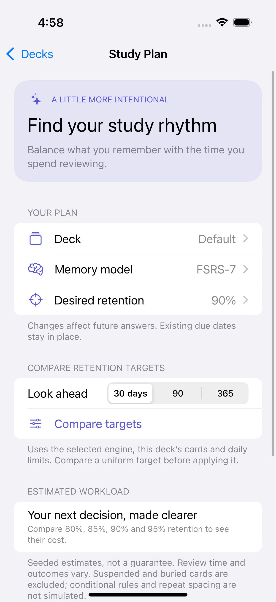
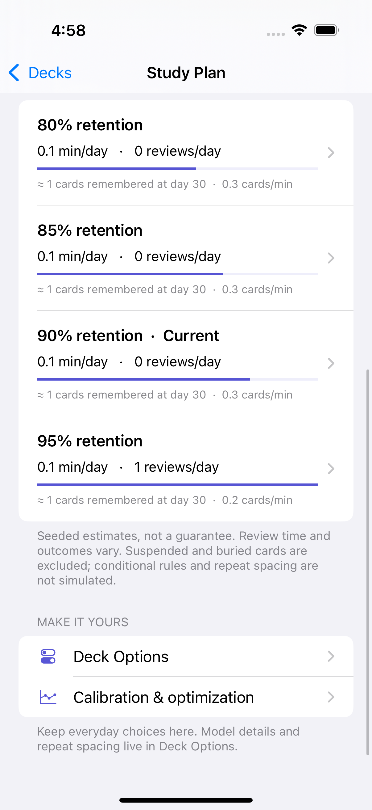
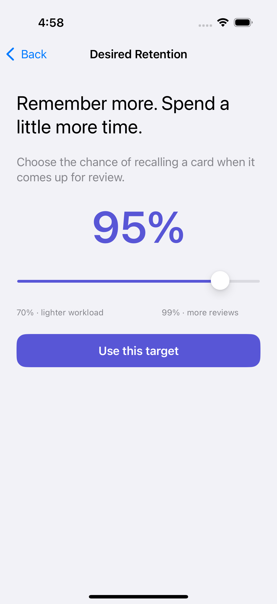
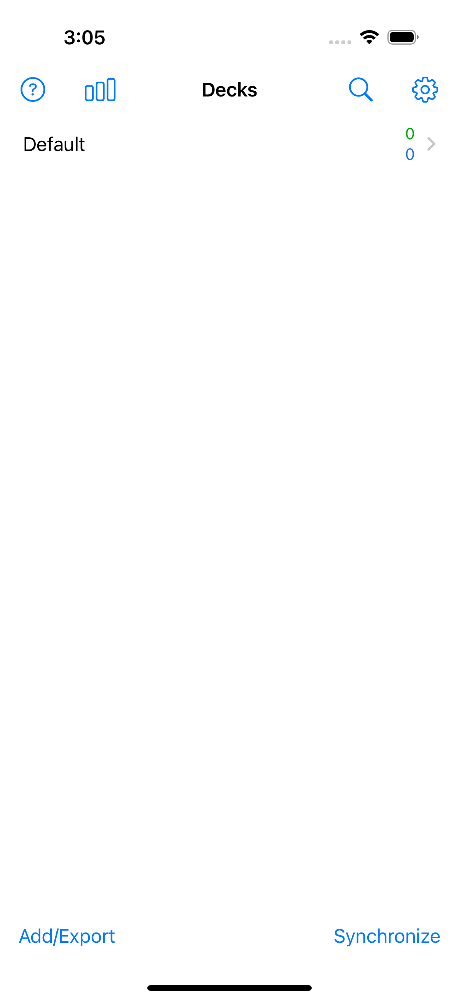
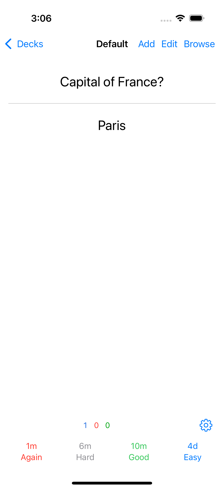

# AnkiMobile rebuild

An editable native iOS flashcard app reconstructed from static analysis of the supplied AnkiMobile 25.09 IPA with [REA](https://github.com/morluto/rea), Ghidra, and Apple's compiled resource metadata.

**This is an initial functional reconstruction, not a complete or pixel-verified AnkiMobile replacement.** It implements the main local flashcard flows. AnkiWeb sync, APKG/SQLite compatibility, and media remain unimplemented. The native scheduling integration adds features from [JSchoreels/anki](https://github.com/JSchoreels/anki); see [the feature map and remaining differences](docs/fork-integration.md). See [fidelity and evidence](docs/analysis.md).

## Build for iPhone or iPad

On a Mac with Xcode 16.4 (or newer) and an iOS simulator runtime installed:

```sh
brew install xcodegen
# Install Rust via rustup if needed: https://rustup.rs
xcodegen generate
open Flashcards.xcodeproj
```

The checked-in project is generated from `project.yml`. After changing target settings or adding source files, regenerate it:

```sh
brew install xcodegen
xcodegen generate
```

Select the `Flashcards` scheme and an iPhone/iPad simulator, then Run. For a physical device, select your own development team in Signing & Capabilities. The minimum deployment target is iOS 15.2.

[GitHub Actions](https://github.com/Ivan-Melck/ankimobile-rebuild/actions) builds and runs the native app on a hosted iPhone simulator. Each run uploads an `ios-simulator-results` artifact with screenshots, the `.xcresult` test bundle, generated Xcode project, build log, and simulator `.app`. A simulator `.app` cannot be installed on a physical iPhone.

## Implemented

- Native deck list with new/review counts; create, rename, configure limits, and delete decks.
- Add/edit Basic, reversed, and Cloze notes with tags and HTML fields.
- WebKit card rendering, tap-to-reveal, four answer ratings with interval previews, keyboard review, undo, bury, and suspend.
- Search by text, `deck:"French Verbs"`, `tag:verbs`, `flag:3`, `is:new`, `is:learn`, `is:review`, `is:due`, `is:suspended`, `is:buried`; combine with spaces and negate using `-`.
- Daily limits, local learning/review queues, review history, and statistics.
- CSV/TSV import with quoted fields and duplicate detection; CSV export; full JSON collection backup/restore.
- System/light/dark appearance and adjustable card text size.
- Atomic persistent storage and validation before backup replacement.

Fresh app collections use **FSRS-7**. Deck Options also offers FSRS-6, RWKV Curve, RWKV Instant, and the original Classic approximation. Study Plan compares retention against workload; saved presets, ordered card rules, repeat spacing, calibration, and FSRS optimization are included. The actual fork inference engines run locally in Rust. Older rebuild backups retain Classic until you select a memory model. JSON backups are specific to this rebuild. CSV imports create Basic notes; CSV exports preserve fields and tags, not note types or scheduling.

## Make changes

| What to change | Location |
| --- | --- |
| Native screens and navigation | `ios/Flashcards/Controllers/` |
| Card font, spacing, colors | `ios/Flashcards/Resources/reviewer.css` |
| Theme and preferences | `ios/Flashcards/Support/AppModel.swift` |
| Card templates and cloze rendering | `Sources/FlashcardsCore/Rendering.swift` |
| Scheduling policy and engine bridge | `Sources/FlashcardsCore/StudyPlanning.swift`, `NativeEngine/src/lib.rs` |
| Classic approximation | `Sources/FlashcardsCore/Scheduler.swift` |
| Models and collection format | `Sources/FlashcardsCore/Models.swift`, `CollectionStore.swift` |
| Search / CSV | `Search.swift`, `DelimitedText.swift` |
| Build settings and targets | `project.yml` |

`ReviewScheduler` is injected for Classic scheduling. Modern scheduling is configured through typed `SchedulingOptions` and a small JSON C ABI, keeping native UI, scheduling policy, and inference code separate. The core is a standalone Swift package with no UIKit dependency:

```sh
scripts/build-native.sh
swift test
cargo test --release --locked --manifest-path NativeEngine/Cargo.toml --features validation --test parity
```

See [architecture](docs/architecture.md), [analysis and fidelity](docs/analysis.md), [verification](docs/verification.md), and [local REA workflow](docs/reproduce-analysis.md). No supplied IPA, original executable, extracted assets, or decompiled original code is published in this repository.

## Simulator captures

The fork integration adds these native planning screens. [Verification and test results](docs/verification.md) include the exact tested revision and remaining runtime limits.

  


Captured from the rebuilt app on an iPhone 16 Pro simulator.

 

This derivative is licensed under GNU AGPL-3.0-or-later. See [third-party notices](THIRD_PARTY_NOTICES.md) for fork/model provenance.
