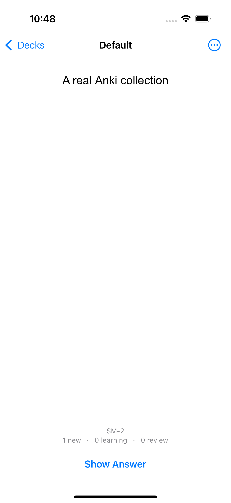
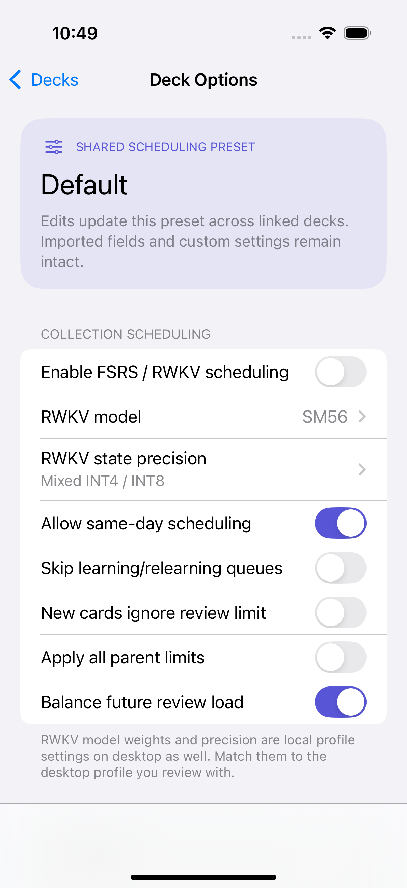
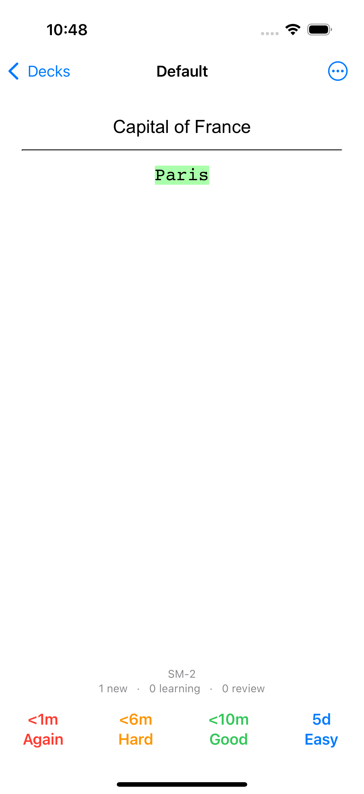

# Verification

## Real Anki collection path

The [iPhone simulator run](https://github.com/Ivan-Melck/ankimobile-rebuild/actions/runs/40139231893) passed at source revision `b9cd43cfe3c34f2fe8db68deed73002b6fe7f699` on 2026-10-24 UTC. The checked-in Xcode project and shared scheme match that generated build byte for byte.

- **54 core tests**, with three optional fixture/server tests skipped in the ordinary run, zero failures.
- Neural prediction-vector checks against the pinned fork, with a maximum absolute error of `1e-5`.
- A separate isolated two-client sync test: collection upload/download, media transfer, edits, review history, distinct-timestamp conflict convergence and note deletion.
- **Nine iPhone UI flows**, zero failures: six native Anki flows and three legacy reconstruction flows.

Native runtime coverage includes create/review/rate/undo/edit/restart persistence, typed answers, real deck-options/sync navigation, image/audio loading, sequential playback without overlap, offline algebra/chemistry typesetting, German/Japanese text, image-occlusion mask pixels and answer reveal, and actual RWKV Instant inference with an FSRS-6 fallback and persisted review history. The collection coordinator also has a source-derived regression through four same-day reviews and undo. The fallback's stored memory state and version survive review and package import/export.

Earlier runs exposed blank review documents, modal keyboard focus, stalled image-occlusion animation frames and missing HTML encoding. The final code waits for the reviewer to appear, validates the loaded document before showing answer controls, allows one bounded recovery, rejects stale navigation callbacks, handles WebKit process termination, declares UTF-8 and adds a one-shot fallback for image-occlusion drawing. The final captures were inspected for the affected rendering and layout issues. Diagnostic fixture labels are part of the test notes, not application status messages.

  

### Private local collection

With the user's authorization, the local profile was copied as database/WAL bytes without opening the source database in SQLite. Source hashes were checked unchanged after testing. Tests use a second disposable copy; collection contents and media were never uploaded or synced to a real account.

The private-fixture run passed **22 checks**, with only the separate server test skipped. Its `.colpkg` export/import comparison preserved **8,478 cards, 6,402 notes, 10 note types, 5 decks, 31,230 canonical RWKV history rows and 13,876 media files**. Every card/note protobuf, template, history row, media filename and media byte sequence matched. This caught and fixed automatic repair on import, which had rewritten note timestamps.

A separate replay smoke check warmed the full canonical history and produced **2,057 candidate predictions in approximately 2.2 seconds** on the local Linux host. This is host performance evidence, not an iPhone large-collection benchmark or desktop order-parity result.

### Acceptance limits

**Full Anki/fork feature parity is not established.** Live AnkiWeb, exact desktop RWKV ordering across mixed presets, filtered RWKV reviews, custom scheduling scripts, advanced native tools and broader device/format cases remain outstanding. Model and state precision are local profile settings and must match desktop for comparable RWKV behavior. See the [compatibility inventory](compatibility.md).

The pinned backend also has unresolved sync races: conflicting note edits within one second can diverge, and a mutation sharing a millisecond with sync completion can be missed because collection mtimes compare equal. Normal-flow tests explicitly separate timestamps; passing them does not certify these races are fixed.

## Earlier JSON-path fork integration

The earlier JSON-based integration has 32 portable XCTest checks, including published initial FSRS intervals, all five RWKV models and four precision modes, answer/preview/undo consistency, persisted preset routing, numeric search, learn-ahead, repeat spacing, backups, real-history calibration/fitting, and forecasts that leave live data unchanged. They pass on Linux and on the macOS runner. The Rust parity harness independently checks SM36, SM40v2, SM55 and SM56 against the fork’s published probability/curve vectors at a maximum absolute error of `1e-5`.

The first integration [simulator run](https://github.com/Ivan-Melck/ankimobile-rebuild/actions/runs/40112241519) passed at source revision `22e5e88ed5a3a6e3c3cb1492a7c0e205ea18e6b1`: 28 core tests, neural vector parity, native iOS build, and three XCUITest flows, zero failures. The additional flow compares retention targets, applies a target, selects RWKV, edits retention, restarts the app, and simulates again using the saved engine.

The subsequent [simulator run](https://github.com/Ivan-Melck/ankimobile-rebuild/actions/runs/40113342780) passed at revision `fb8d06b117fccd7c05ad4cc04bfa6a08fb99e25e`: **32 core tests, neural vector parity, native iOS build and all three XCUITest flows, zero failures.** Screenshots below were inspected for layout and clipping; the retention editor’s fixed-height subtitle was replaced by a scrolling layout. Those legacy captures predate the native Anki collection path.

After that run, three small presentation changes shorten “Scheduling preset” to “Preset”, display fractional reviews/day, and place Card Rules’ Edit beside Add so Back remains visible. Those Swift files were parser-checked; the recorded simulator captures precede these presentation-only changes.

  

## Initial reconstruction baseline

The initial native code revision was `e25ead87877601ada4449a6887faf0e9cb7452f2`. Its [GitHub simulator run](https://github.com/Ivan-Melck/ankimobile-rebuild/actions/runs/40105137856) builds the app with Xcode 16.4 on a macOS 15 hosted runner and uses an iPhone 16 Pro simulator. **Result: passed — 17 core tests and both XCUITest flows, zero failures.** See that run for the logs, `.xcresult`, screenshots, and simulator `.app`.

The portable core suite contains 17 behavior tests covering note/card generation, cloze templates, scheduling and interval previews, daily limits and rollover, undo, suspend/bury/move/deck deletion, quoted search, CSV quoting/Unicode/duplicates, import rollback, backup validation, persistence and failed-save rollback. `swift test` passes locally on Linux and on the macOS runner.

The two XCUITest flows exercise:

- Add a note, study it, tap the card to reveal its answer, rate it, undo, browse/edit it, terminate the app and verify the edit after relaunch.
- Create a deck, switch to dark appearance, and return to the deck list.

Screenshots are captured at deck list, editor, question, answer, browser, dark preferences and dark deck list states. Selected permanent copies are in [screenshots/](screenshots/). These are screenshots of the rebuild. They are not reference images from the original IPA and do not establish pixel equality.

The source supports iPhone and iPad with an iOS 15.2 deployment target. Runtime checks so far cover the hosted iPhone simulator. Physical devices, older iOS runtimes, iPad, landscape, large collections, the full accessibility workflow, and exact original-app fidelity remain unverified.
